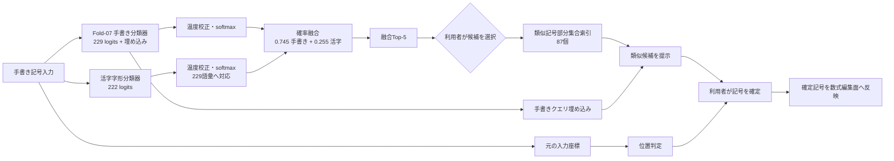

# 火の鳥アンサンブルモデル設計

## 目的

火の鳥は、手書きの孤立記号を229記号の共通語彙で順位付けし、利用者が候補を選んで確定する端末内モデルである。対象は記号単体であり、数式全体の読み取りやMathML構造の自動確定ではない。

## 構成

| 段階 | 構成要素 | 入力と出力 | 責務 |
|---|---|---|---|
| 1 | Fold-07手書き分類器 | 手書き記号画像 → 229クラスのlogitと記号埋め込み | 手書き形状を分類し、候補の基礎分布とプロトタイプ比較用表現を出す |
| 2 | 活字字形分類器 | 同じ手書き記号の64×64二値画像 → 対応する222クラスのlogit | 活字字形データで学習した視覚枝から補助候補分布を出す。未対応の7クラスには確率を割り当てない |
| 3 | 確率アンサンブル | 2枝のlogit → 229クラスの融合確率とTop-5 | 枝ごとに温度校正してから、校正ファイルの重みで確率を加算し、共通語彙上で順位付けする |
| 4 | 類似記号部分集合索引（87個） | 利用者が選んだTop-5記号と手書き埋め込み → 部分集合内候補 | 選択記号を含む部分集合を引き、入力埋め込みとの類似度順に候補を提示する |
| 5 | 位置判定・利用者確定 | 候補と元の座標・領域情報 → 確定操作 | 位置関係は類似度とは独立した後段判定として扱う。曖昧な記号は利用者が確定する |

## 全体構造

## 確率融合

Fold-07の229クラス確率を `P_hand`、活字枝の222クラス確率を229語彙へ対応付けた分布を `P_type` とする。活字枝が対応しない7クラスの値は0とする。融合分布は次の通り。

`P_ensemble = 0.745 × P_hand + 0.255 × P_type`

各 `P` は、それぞれのlogitを対応する温度で割ってsoftmaxした確率である。現在の校正値は手書き枝2.3843857、活字枝1.2786507。Top-5は融合分布から一度だけ作り、枝ごとのTop-5を単純連結しない。各候補には共通語彙の記号ID、表示記号、融合確率を保持する。

## 類似記号部分集合の導出

ここでいう87は部分集合の個数であり、分類モデル名や類似概念の名称ではない。手書きデータを教師として学習する段階ではなく、活字字形画像から画素支持特徴とコサイン類似度を作り、類似記号部分集合へまとめるデータ処理である。

1. 229記号の活字輪郭・骨格画像68,689枚と、解像度違いの合成画像540枚を集める。
2. 記号ごとに、各画素が画像集合内で有効になった割合を計算する。割合が0.30以下の画素を0にし、それより大きい画素を特徴として残す。
3. 229記号の全組合せ26,106対について特徴ベクトルのコサイン類似度を計算する。未定義の228対を除き、類似度0.30以上の7,413対を類似関係として採る。
4. 類似対をコサイン類似度の高い順に処理し、同じ部分集合内の全ての記号対が閾値を満たす場合に限って追加する。記号は複数の部分集合に所属できる。408個の重複可能な部分集合を得る。
5. 4記号以下の部分集合を除き、234個を残す。残った部分集合同士は、どの組合せを取っても3記号以上を共有する場合に限り、最小共有数が大きい組から統合する。完全連結条件で119個に統合する。
6. 統合後の部分集合のうち、記号数が15未満のものを採用する。この手順で87個の類似記号部分集合を得る。

導出記録: `runs/agent-control/cycle655-support30pct-cosine/report.json`、`cycle658-cosine-overlap-clique-cover-030/report.json`、`cycle660-subsets-min-size-5/report.json`、`cycle661-merge-k3-complete-link/report.json`、`cycle662-groups-under-15/report.json`。最終の各記号と部分集合の対応は、下記JSON成果物に格納する。

この部分集合索引は学習済み分類器の第三枝ではなく、融合後の候補を補助展開する索引である。部分集合への所属は保存済み定義で決まり、入力ごとの提示順はFold-07埋め込みと記号プロトタイプ間のコサイン類似度で決まる。展開は融合確率、Top-5順位、記号IDを変更せず、同じ意味・同じUnicode記号であるとも断定しない。

## 利用者への提示と確定

1. 入力記号ごとにFold-07枝と活字枝を推論する。
2. 校正済み確率を229記号語彙上で融合し、Top-5を提示する。
3. 利用者が候補を選ぶと、その記号が含まれる類似記号部分集合を参照し、部分集合内の類似候補を提示する。
4. 位置判定は類似度判定と混ぜず、保持した座標情報を使って別に行う。
5. 利用者が記号を確定して初めて、確定済み記号を数式編集面へ反映する。

入力ストローク、座標、各枝の出力、融合Top-5、部分集合IDと類似度、位置判定根拠、利用者の確定結果は、それぞれ由来を区別して保持する。未確定候補を確定済み数式として扱わない。

## 実装との対応

- 融合校正値と語彙対応: `Models/Hinotori/Ensemble/HinotoriCandidateEnsemble.json`
- 手書き枝と類似記号部分集合索引: `Sources/ArcaneDerivationCore/HinotoriFold7CoreMLClassifier.swift`
- 活字枝と確率融合: `Sources/ArcaneDerivationCore/HinotoriTypesetAuxiliaryCoreMLClassifier.swift`
- 入力から候補生成まで: `Sources/ArcaneDerivationCore/HinotoriFormulaFold7Engine.swift`
- 類似記号部分集合の定義（87個）: `Models/Hinotori/Fold07SpatialPyramid/HinotoriPrototypeCosineSimilarityGroups.json`

関連する入力・確定契約は[数式入力アーキテクチャ](MathInputArchitecture.md)、活字枝の詳細は[活字字形補助分類器設計](../ModelConversion/HinotoriTypesetAuxiliaryHeadDesign.md)を参照。
